# Maricho App UI

The screens below are the approved app UI ("Maricho Recruitment – App UI" design canvas).
They replace the earlier SVG/JPG wireframes. Each PNG is rendered at 390×844 (2× scale);
the matching static HTML source is in [`html/`](./html).

The web frontend in [`/frontend`](../frontend) is built to match these screens.

## Getting started — both users

| # | Screen | Image | Source |
|---|---|---|---|
| 1 | Welcome – choose your path |  | [Main.html](html/Main.html) |
| 2 | Sign up with phone number | 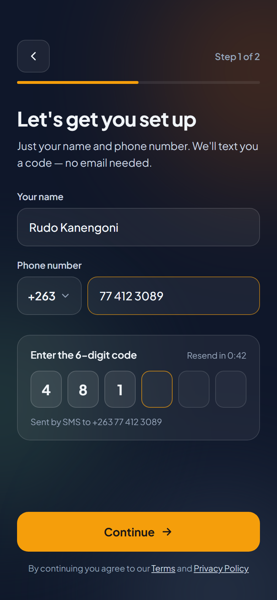 | [SignUp.html](html/SignUp.html) |
| 3 | Messages (both users) | 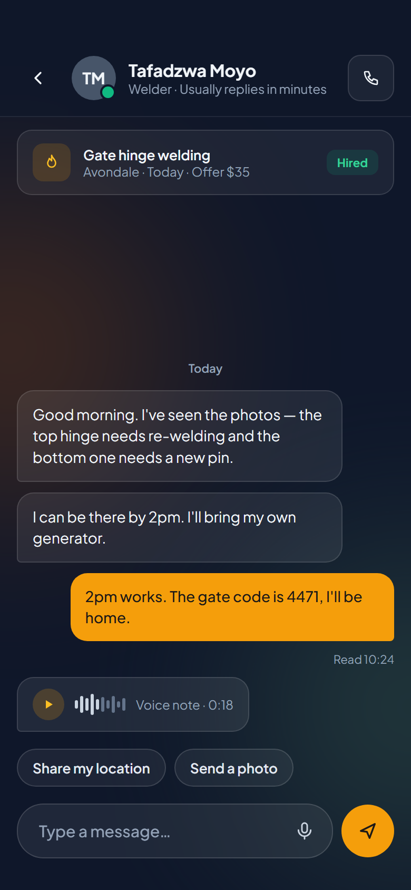 | [Chat.html](html/Chat.html) |

## Employer — getting a job done

| # | Screen | Image | Source |
|---|---|---|---|
| E1 | Employer home | 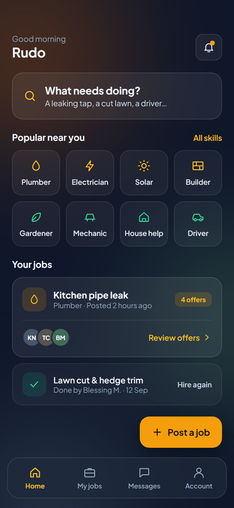 | [EmployerHome.html](html/EmployerHome.html) |
| E2 | Post a job | 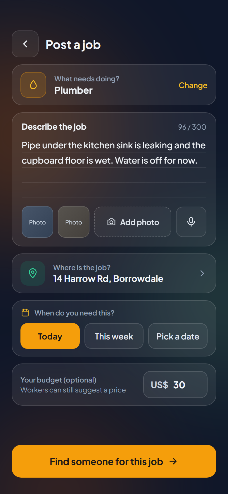 | [PostJob.html](html/PostJob.html) |
| E3 | Pick the skill needed | 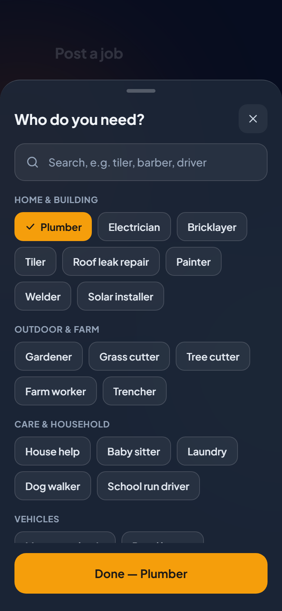 | [TradePicker.html](html/TradePicker.html) |
| E4 | People who offered to help | 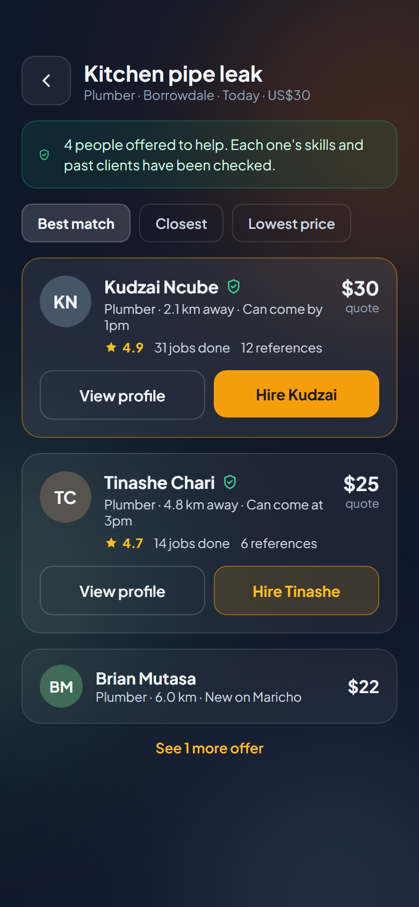 | [Applicants.html](html/Applicants.html) |
| E5 | Worker profile & references | 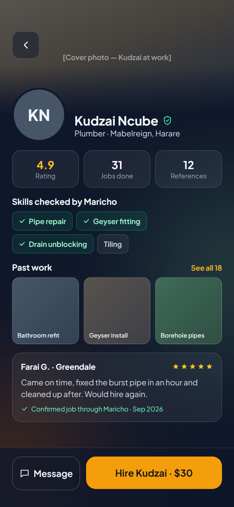 | [WorkerProfile.html](html/WorkerProfile.html) |
| E6 | Job progress, confirm & review | 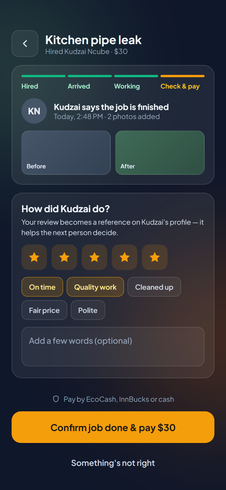 | [JobTracking.html](html/JobTracking.html) |

## Worker — finding and doing work

| # | Screen | Image | Source |
|---|---|---|---|
| W1 | Set up your skills | 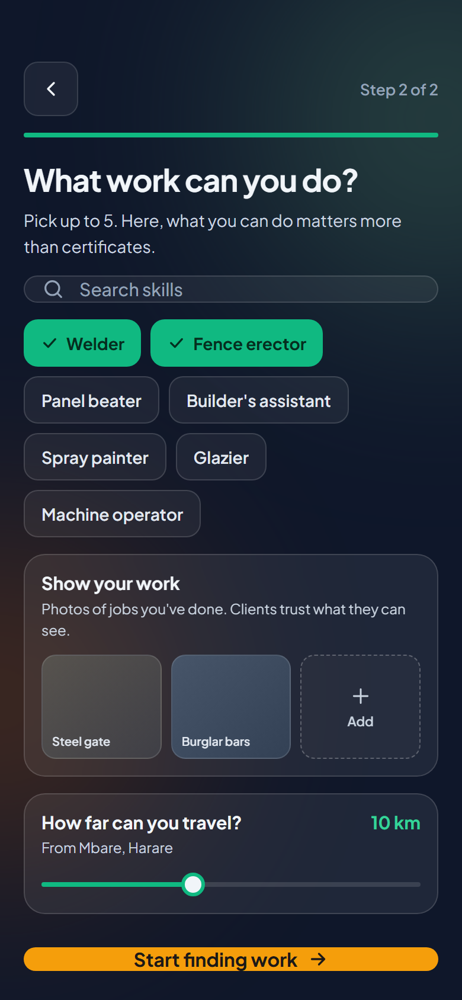 | [WorkerSkills.html](html/WorkerSkills.html) |
| W2 | Jobs near you | 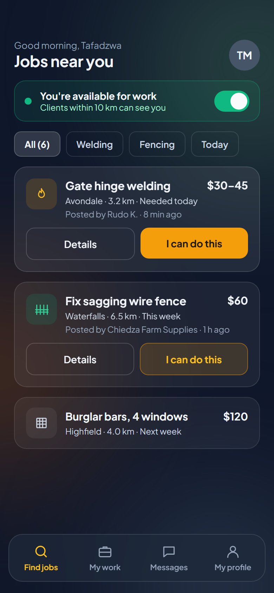 | [WorkerHome.html](html/WorkerHome.html) |
| W3 | Job details & make an offer | 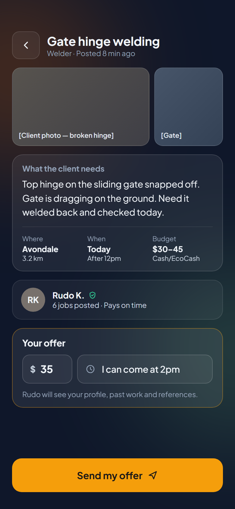 | [JobDetail.html](html/JobDetail.html) |
| W4 | My work, earnings & references | 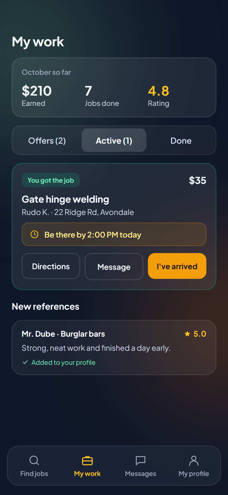 | [MyWork.html](html/MyWork.html) |

## Design tokens (from the screens)

- Background `#0F172A` (slate-900) with blurred colour glows: amber `#B45309`, moss `#3F6B57`, slate `#334155`
- Primary action: amber `#F59E0B`, text on it `#1C1917`; links `#FBBF24`
- Worker accent: emerald `#10B981` / `#34D399`
- Text `#F1F5F9`, secondary `#CBD5E1`, muted `#94A3B8`
- Glass surfaces: `rgba(255,255,255,0.06–0.08)` fill, `rgba(255,255,255,0.12–0.14)` border, `blur(20px)`
- Font: Plus Jakarta Sans 400/500/600/700
- Radii: cards 18px, inputs 14px, chips/buttons 12px, primary CTA 16px × 56px tall
